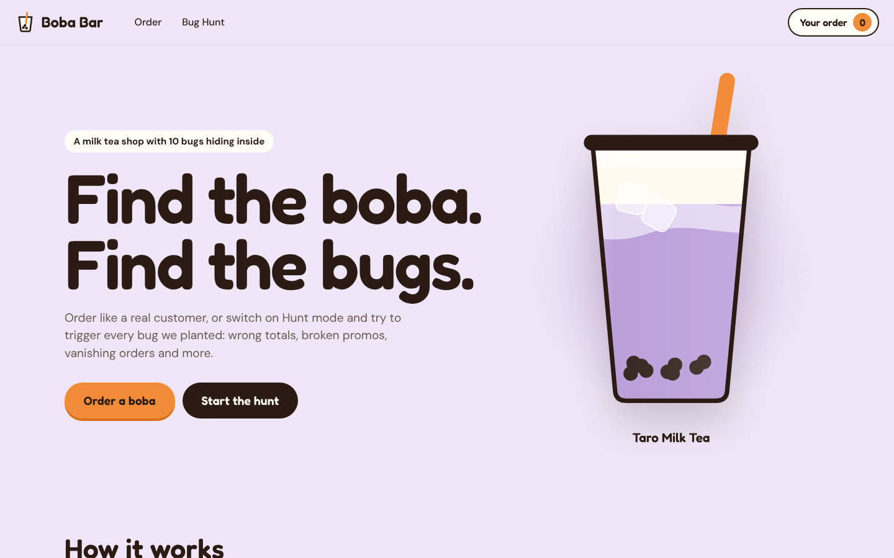
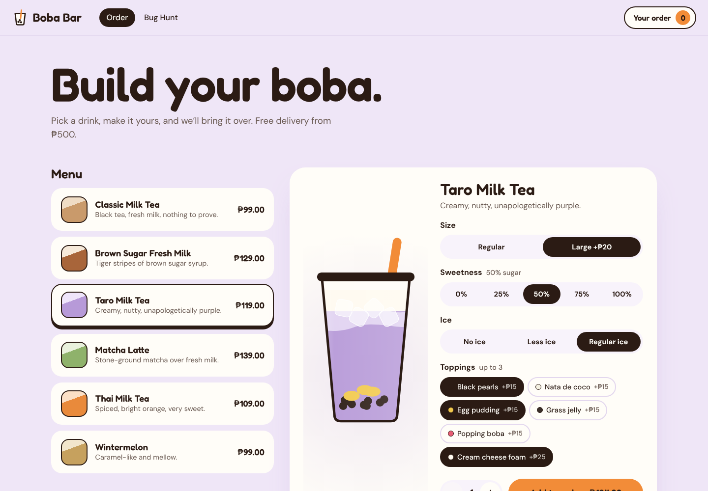
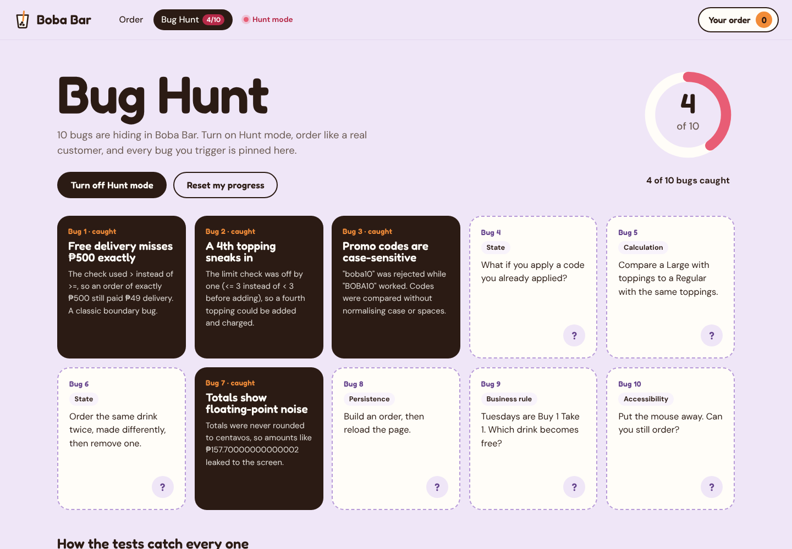

# Bug Hunt 🐞🧋

[](https://github.com/666yunoGASAI/bug-hunt/actions/workflows/ci.yml)

**A milk tea shop with 10 bugs hidden inside, a test suite that provably catches every one, and mutation testing to prove the tests themselves are good.**

> **Play it:** _add your Vercel link here_ · Hit **Start the hunt** and try to trigger all 10 bugs.



---

## The idea

Most test suites are trusted on faith: "the tests pass, so the app works." Bug Hunt asks a harder question: **would these tests actually catch a real bug?**

So I planted 10 realistic bugs in a working app, each behind a switch, and built tooling to prove the answer is yes:

| | |
|---|---|
| 🧋 **Boba Bar** | A real ordering flow: build a drink (animated cup, toppings that drop in), promo codes, Buy 1 Take 1 Tuesdays, delivery fees, checkout with Philippine mobile validation |
| 🐞 **10 planted bugs** | Boundary values, off-by-one, input handling, state, rounding, persistence, timezone-dependent business rules, accessibility |
| 🎯 **Catch matrix** | Turns each bug on **by itself**, runs every test, and fails the build if any bug escapes ([docs/CATCH_MATRIX.md](docs/CATCH_MATRIX.md)) |
| 🧬 **Mutation testing** | Stryker breaks the pricing code in 288 small ways; **98.96%** of those changes are caught (100% on the order rules) |
| 🎮 **Hunt mode** | Visitors switch the bugs on and try to trigger them; each one they find flips over on the board |





## Test strategy

| Layer | Tool | Count | What it proves |
|---|---|---|---|
| Unit | Vitest | 76 | Every pricing, promo, delivery, cart and checkout rule, including exact boundaries (₱500, 3 toppings, 2-char names, 10-char addresses) |
| Property-based | fast-check | 5 properties × 300 random orders | Totals are always whole centavos, never negative, always add up; B1T1 always frees the cheapest drinks |
| End-to-end | Playwright + page objects | 35 scenarios × 4 browsers | Real customer journeys on Chromium, Firefox, WebKit and mobile Chrome |
| Accessibility | axe-core + keyboard tests | 7 | WCAG 2.1 A/AA on every screen; a keyboard-only customer can order; the drawer handles focus and Escape |
| Time control | `page.clock` + `timezoneId` | 3 | Buy 1 Take 1 follows **Philippine** time: a customer in Los Angeles on Monday evening already gets Tuesday's promo |
| **Catch matrix** | custom script | 10 bugs × full suite | Each bug, alone, makes at least one test fail |
| **Mutation testing** | Stryker | 288 mutants | The tests notice when the code changes, not just that it runs |

## What the testing actually found

The best evidence that a suite works is what it caught *while I was building*, beyond the 10 bugs I planted on purpose:

1. **An infinite render loop.** With every bug on, the app went blank. Planted bugs report themselves while prices are being calculated, which updated React state *during* render, which re-rendered, which reported again. Fixed by recording reports and updating state after the render.
2. **"Turn on Hunt mode" did nothing on the Hunt page.** `location.replace()` to the same URL with a `#fragment` is an in-page jump, not a reload.
3. **A bug announced itself without being triggered.** `useRef(loadOrder())` calls `loadOrder()` on *every* render, because the argument is evaluated each time. It should only run once (lazy `useState`).
4. **Contrast failures** in the Hunt-mode badge and banner (white on pink, 3.4:1), and a `<p>` inside a `<dl>`. axe found both; colours fixed to 6:1.
5. **The first catch matrix was misleading.** Every bug "failed 6 E2E tests", because accessibility tests failed whenever Hunt mode was on, whatever the bug. After fixing the contrast, each bug fails only the tests written for it.
6. **Mutation testing found gaps in my unit tests**: 23 code changes no test noticed, and 18 more in code no test even ran. For example, nothing proved drinks differing only in **size** or **ice** stay on separate lines, and nothing proved the `^` anchor in the mobile-number regex mattered. The score went from 85.8% to 98.96%; the 3 survivors are equivalent mutants (changes that can't alter behaviour).

## How the bugs are wired

Every bug sits behind one switch, so the correct and buggy code live side by side:

```ts
let free = afterDiscounts >= FREE_DELIVERY_FROM;
// Stryker disable next-line all: planted bug
if (bug('free-delivery-boundary')) free = afterDiscounts > FREE_DELIVERY_FROM;
```

- Normal visitors and the test suite run with **no** bugs on.
- **Hunt mode** turns all of them on. When a buggy path actually produces a wrong result it calls `triggered(id)`, and the Hunt board reveals that bug.
- The catch matrix sets `BUGS=<one id>` for Vitest, and a Playwright fixture passes the same value to the browser.
- Planted-bug lines are excluded from mutation testing, since they aren't part of the real product.

## Run it locally

Requires **Node.js 20+**.

```bash
npm install
npx playwright install

npm run dev              # http://localhost:5173 (landing) · /#/order (shop) · /?bugs=all#/hunt (Hunt mode)
npm run test:unit        # unit + property tests
npm run test:e2e         # E2E on all 4 browser projects
npm run test:e2e:ui      # watch the E2E tests run step by step
npm run catch-matrix     # prove every planted bug is caught (~5 min)
npm run mutation         # Stryker; report in reports/mutation/index.html
```

## Project structure

```
src/
  lib/bugs.ts            # the bug switchboard: catalogue, on/off, "triggered" reports
  lib/order.ts           # every order rule (pure functions)
  lib/storage.ts         # saved order
  components/Cup.tsx     # the animated cup (Framer Motion)
  pages/, components/    # React UI
tests/
  unit/                  # Vitest + fast-check
  e2e/pages/             # page objects
  e2e/fixtures.ts        # bug switch + browser clock as test options
  e2e/specs/             # the E2E tests
scripts/catch-matrix.ts  # the bug-by-bug proof
stryker.config.json      # mutation testing (build fails below 95%)
docs/CATCH_MATRIX.md     # latest matrix result
```

---

Built by **Akinon** · QA automation showcase
